<!--
SPDX-FileCopyrightText: 2026 Kasa Panel contributors

SPDX-License-Identifier: GPL-3.0-or-later

SPDX-FileContributor: Claude Opus 5 (AI-generated)
AI usage declaration: docs/ai-bom.spdx.json
-->

# Architecture

This is a [C4 model][c4] of Kasa Panel: the same system drawn at four
levels, each one closer in than the last. Read it from the top. If you
only want to know what the daemon talks to, the first diagram is the
whole answer and you can stop there.

Each diagram is a [Mermaid][mermaid] block in this file, which is the
only copy. GitHub renders them where you are reading them, and
[the diagrams workflow](../.github/workflows/diagrams.yml) renders the
same blocks to SVG and PNG on every push, so there is no second copy to
fall out of date. See [Rendering](#rendering) at the foot.

Mermaid's C4 support is marked experimental upstream, and its layout is
a grid with straight lines rather than a router. That is why the
component level is split into several small diagrams instead of one
large one: a component diagram with a dozen boxes in it renders as a
thicket, and is not much use to read either. The `UpdateRelStyle` lines
at the foot of some blocks nudge edge labels off each other by hand. If
you change a label's text, expect to adjust its offset.

[c4]: https://c4model.com/
[mermaid]: https://mermaid.js.org/syntax/c4.html

## Level 1: system context

Kasa Panel is a daemon on one host on your LAN. It has no cloud
account, no telemetry, and no outbound connection to anything but your
own devices.

The host's own account database signs people in, which is why PAM is a
system of its own here: the panel has no user list and deliberately
never grows one.

<!-- diagram: 01-system-context -->

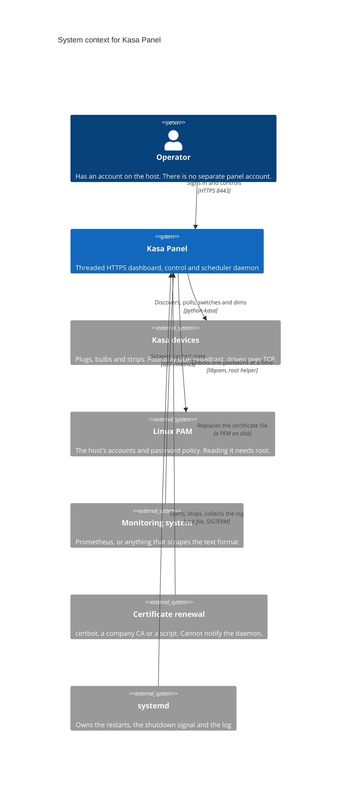

## Level 2: containers

Four things run, and three of them are files. The split that matters is
the second process. PAM needs root; nothing else does. A thread cannot
hold a different identity from the process around it, because glibc
broadcasts `setuid` to every thread deliberately. So the daemon forks a
helper before any thread exists, keeps root only there, and drops
everything else.

What that buys: anyone who takes the web server gets a socket on which
the only sentence that can be said is "is this password correct",
answered yes or no.

<!-- diagram: 02-containers -->

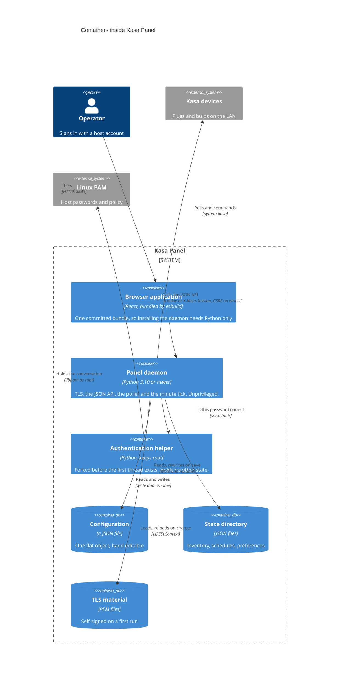

## Level 3: components

The daemon has twenty-two modules and the browser application has
fourteen. Drawn together they are unreadable, so the level is split
into four views of the daemon and two of the interface. Each view names
the boxes that belong to it and refers to the rest as one box.

### The request path

`httpd` knows about sockets and nothing else; `api` knows about JSON
and nothing about sockets. That line is what lets the handlers be
called directly from tests, with no server running.

`metrics` sits beside `api` rather than inside it because it answers to
a different rule: a scrape reads the snapshot cache the poller filled,
and stops there. A monitoring system polling every fifteen seconds must
not become fifteen-second traffic to every plug in the house.

<!-- diagram: 03-components-request -->

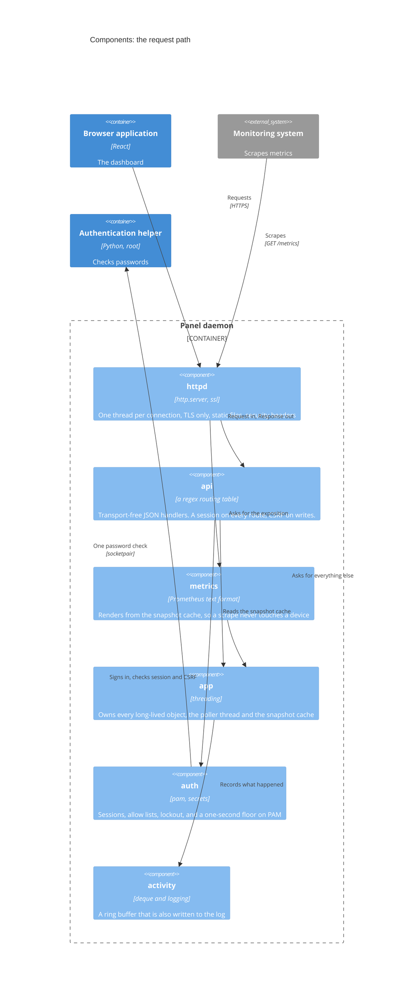

### Starting up and staying up

The order in this diagram is the whole point of it. The helper is
forked while the process is still single-threaded and before the
listening socket exists, so it can never hold one. `filecheck` runs
*after* the drop, because "can root write this file" is not the
question anyone cares about.

`certwatch` and `logsink` both exist because a file the daemon opened
at start up may not be the file at that path an hour later. One handles
a renewed certificate, the other a rotated log.

<!-- diagram: 04-components-lifecycle -->

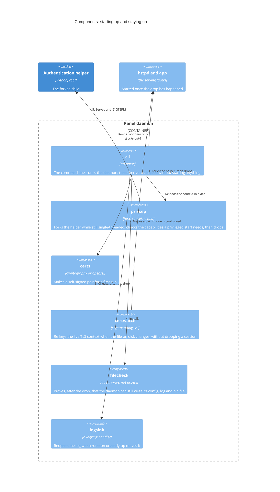

### The schedule language and the device boundary

The language is three modules, not one, so each can be tested on its
own: `cron` parses the time half, `actions` declares the verb half, and
`schedule` is the line that joins them. `actions` is shared with the
JSON API and the dashboard buttons, which is why a button and a
schedule rule cannot mean different things.

`kasabridge` is the only module that imports python-kasa. Everything
above it is testable without a smart plug on the network, which is the
entire reason the boundary exists.

<!-- diagram: 05-components-schedule -->

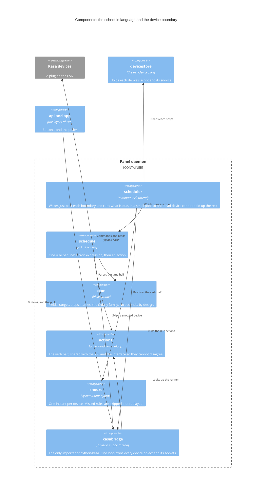

### Persistence

Every piece of state is its own JSON file, and every write goes through
one module. `jsonstore` writes to a temporary file in the same
directory and renames it over the target, so a crash mid-write cannot
leave a truncated file behind — which is also why the daemon account
must be able to write the *directory*, not just the file.

The inventory and the per-device files are split so that a device can
be backed up, copied or hand-edited on its own, and so the inventory
stays short enough to read.

<!-- diagram: 06-components-storage -->

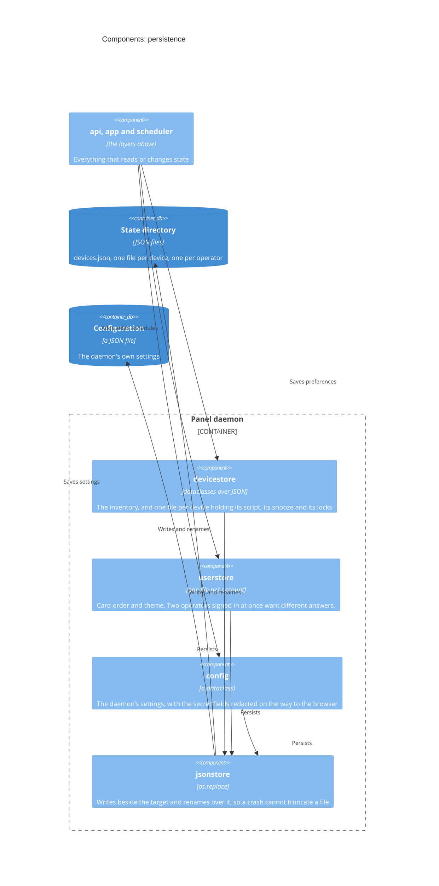

### The browser application: shell

One module talks to the daemon and the rest do not, which keeps session
handling in a single place. The session travels two ways — an HttpOnly
cookie and an `X-Kasa-Session` header — because a browser refuses to
store a `Secure` cookie from an origin whose certificate it does not
trust, which is every self-signed first run. A custom header cannot be
attached by a cross-site form, so this costs nothing in CSRF terms.

<!-- diagram: 07-components-browser-shell -->

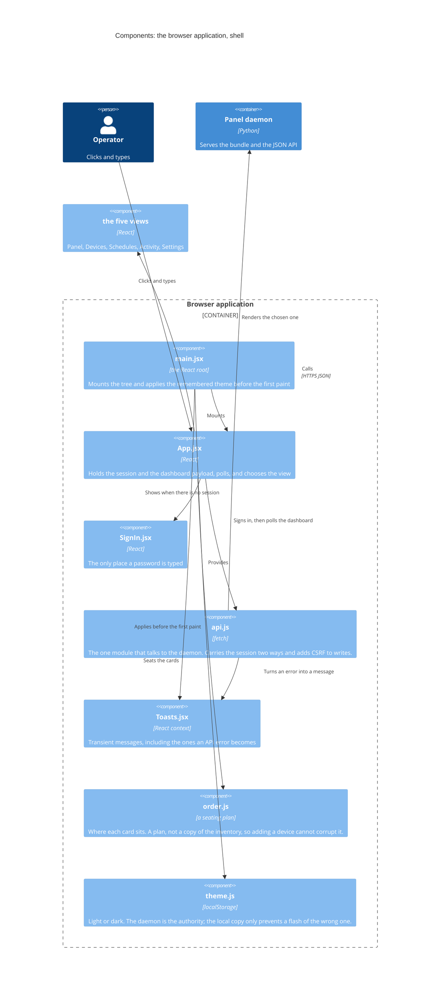

### The browser application: views

Each tab is one module and each one calls `api.js` rather than holding
its own idea of the session. `ConfirmLock` is the odd one: it is not a
tab but a gate, and both the panel and the schedule editor put it in
front of anything that would change a locked device. When the device is
`secure_locked` it asks for the operator's password as well, which goes
back through PAM like any other sign-in.

<!-- diagram: 08-components-browser-views -->

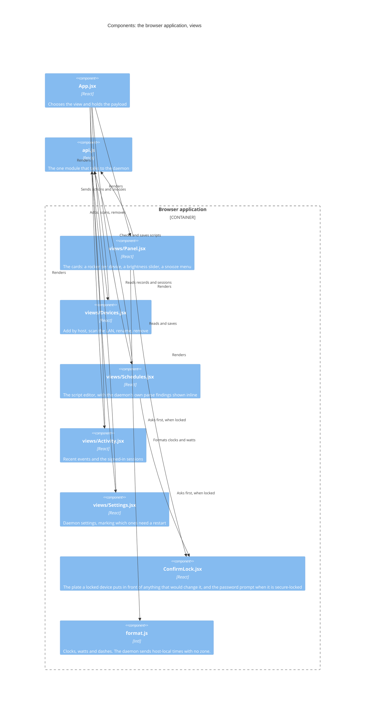

## Dynamic views

Two sequences are worth following, because in both the interesting part
is which process does the work.

### Signing in

The daemon never learns whether the password was right; it learns a yes
or a no from a process it cannot read. Note the fifth step: `auth`
refuses an empty password and applies the rate limit and the lockout
*before* the helper is engaged, so neither an empty field nor a flood
of attempts ever reaches PAM.

<!-- diagram: 09-dynamic-sign-in -->

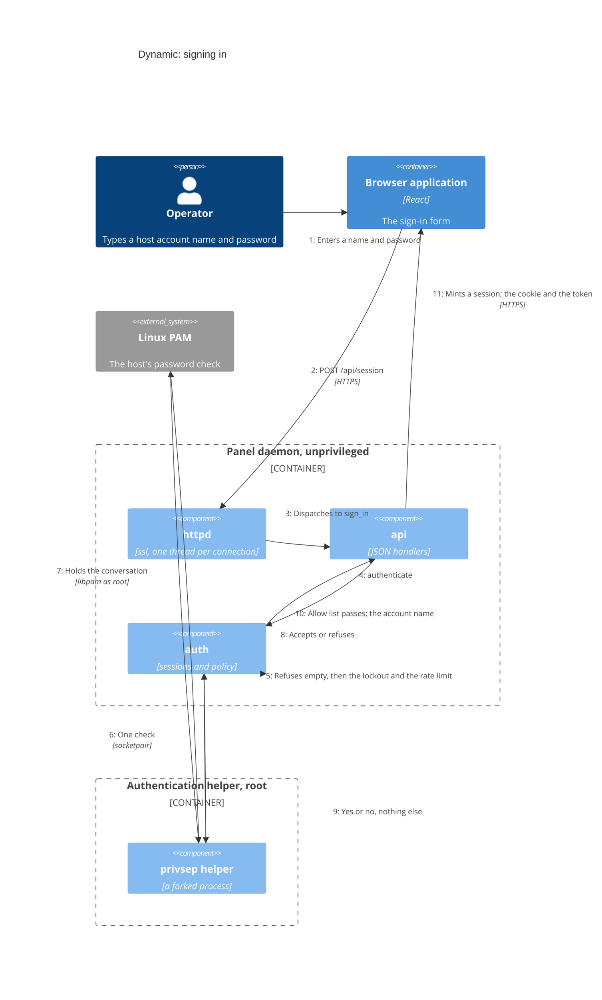

### A schedule minute

The scheduler wakes a moment after the boundary rather than on it,
reads every device's script fresh, and runs what is due in a pool.
Times are the host's local time, exactly like cron: rules in a skipped
hour do not run, and rules in a repeated hour run twice.

<!-- diagram: 10-dynamic-schedule-tick -->

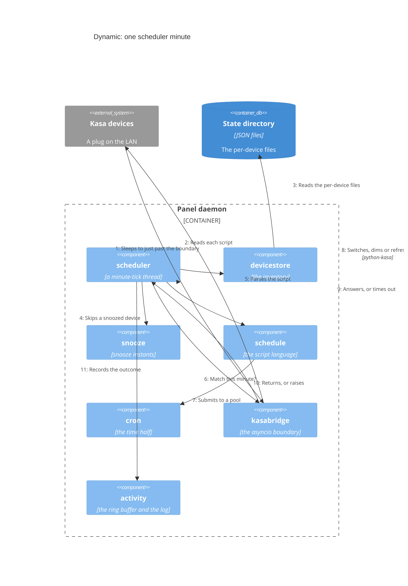

## Deployment

One host, one unit, two processes. Nothing is containerised and nothing
needs to be: the daemon's dependencies are Python and python-kasa.

Running in the foreground under systemd is the arrangement to prefer,
even though `--daemonize` exists. systemd then owns the restarts, the
log and the shutdown signal, and does all three better than a
double-forked process can.

<!-- diagram: 11-deployment -->

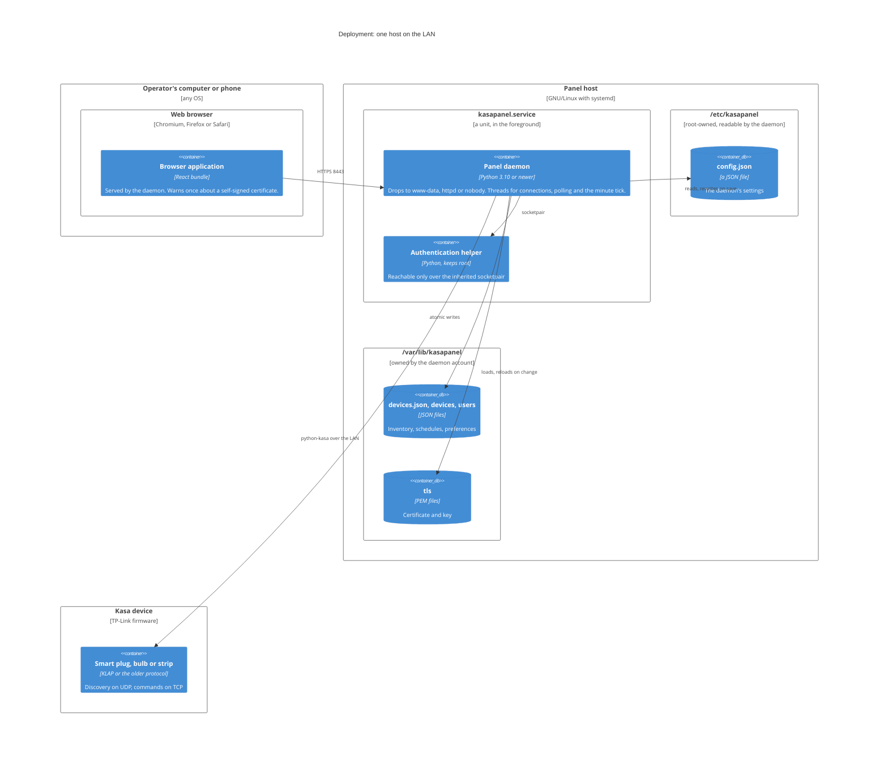

## Rendering

The blocks above are the source. To get image files from them:

```sh
npm ci                 # at the top of the tree, not in frontend/
npm run diagrams       # SVG and PNG into build/diagrams/
```

`tools/render_diagrams.py` pulls each block out of this file, names it
from the `<!-- diagram: ... -->` comment above it, and hands it to
[mermaid-cli][mmdc], which drives a headless Chromium. The output is
not committed: GitHub renders the blocks directly, and a committed copy
would be one more thing to forget.

Two things the script does that a bare `mmdc` call does not:

- It sets a web-safe font stack for every C4 shape, because Mermaid's
  C4 theme asks for Open Sans and then embeds twenty `@font-face` rules
  carrying the whole typeface — about 350 kB of base64 in every file,
  and Open Sans's Apache-2.0 licence dragged into a GPL document for
  nothing. With the stack set, nothing refers to the embedded copy, and
  the script drops those rules: an SVG goes from 380 kB to about 40 kB
  and renders identically. If a future Mermaid uses the font for
  something, the check notices and the rules are kept.
- It names the block that failed, and the line it starts on. `mmdc`
  handed a whole Markdown file numbers the output and says only that
  something went wrong, which is no help with eleven diagrams in one
  file.

Chromium is not installed by `npm ci` here, because the project leaves
Puppeteer's download script denied — see `allowScripts` in
`package.json`, the same arrangement esbuild has in
`frontend/package.json`. The script looks for `chromium` and then
`google-chrome` on the path; to name a different one:

```sh
PUPPETEER_EXECUTABLE_PATH=/usr/bin/chromium npm run diagrams
```

The workflow does the same on GitHub's runners and uploads the images
as a build artifact. It fails if any block stops parsing, which is the
point: a diagram that no longer renders should not reach `main`
quietly.

[mmdc]: https://github.com/mermaid-js/mermaid-cli
